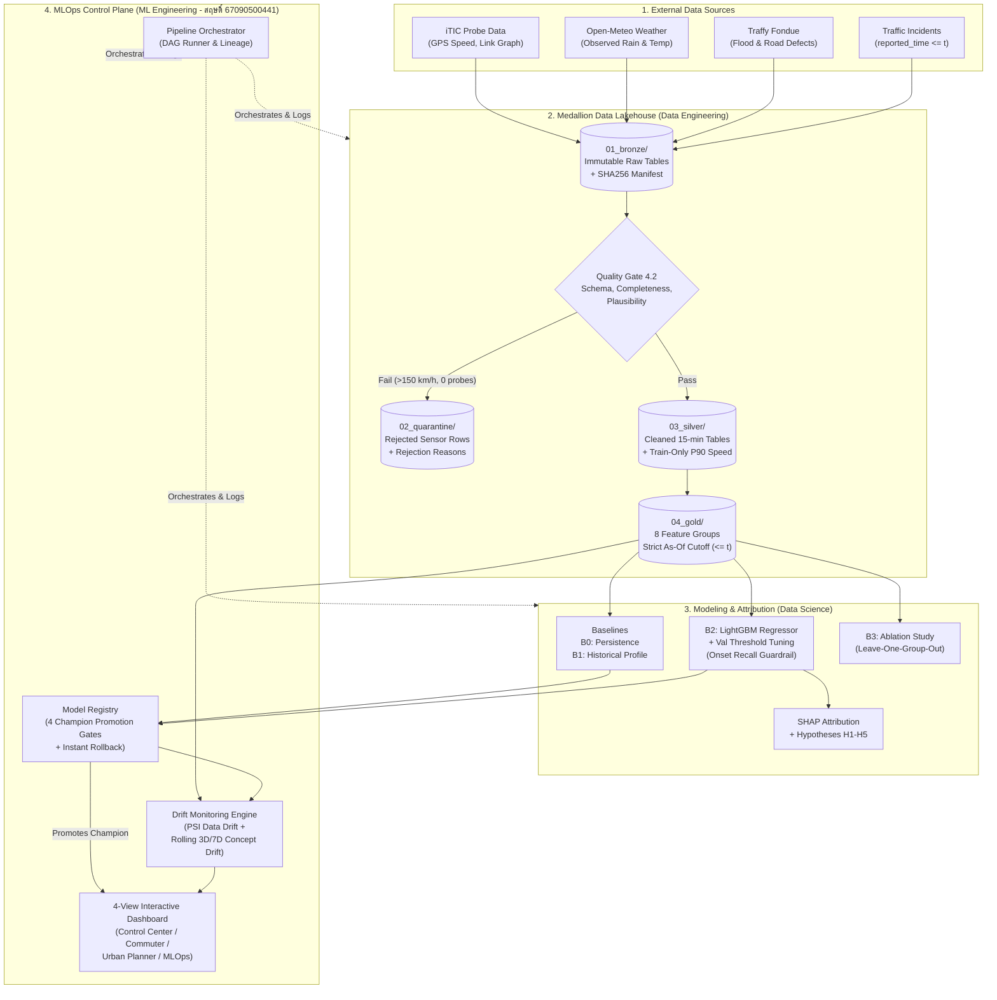

# 🏛️ สถาปัตยกรรมระบบวิศวกรรมข้อมูลและ MLOps (System & MLOps Architecture)

> **โครงการ:** ระบบพยากรณ์จุดรถติดในกรุงเทพมหานครล่วงหน้า 1 ชั่วโมง และวิเคราะห์ปัจจัยที่ทำให้รถติด  
> **วิชา:** CSS 342 Data Science and Data Engineering  
> **ผู้รับผิดชอบสถาปัตยกรรม MLOps, Pipeline Orchestration, Registry, Monitoring & Dashboard:** สฤษดิ์ (67090500441)

---

## 1. ภาพรวมสถาปัตยกรรมระดับสูง (End-to-End System Architecture)

ระบบถูกออกแบบตามสถาปัตยกรรม **Medallion Lakehouse + Automated MLOps Control Plane** ที่แยกชั้นข้อมูล (`Bronze` $\rightarrow$ `Quarantine` $\rightarrow$ `Silver` $\rightarrow$ `Gold`) ออกจากชั้นการจัดการโมเดล (`Model Registry` $\rightarrow$ `Drift Monitor` $\rightarrow$ `Interactive Dashboard`) อย่างชัดเจน



---

## 2. รายละเอียด 4 โมดูลหลักฝั่ง ML Engineering (สฤษดิ์ 67090500441)

### 2.1 Pipeline Orchestration & Lineage (`src/ml_engineering/pipeline_runner.py`)
ควบคุมการรันงานทั้งหมดในรูปแบบ **Directed Acyclic Graph (DAG) 8 ขั้นตอน**:
1. **`synthetic`**: สร้างชุดข้อมูลจำลองตามโครงสร้างจริงของกรุงเทพฯ (32 ช่วงถนนหลัก, 4 โซนอากาศ, 12 เขต, จำลองเหตุการณ์น้ำท่วมใหญ่ 21 ก.ค. 2022)
2. **`ingest`**: ตรวจสอบ Data Contract 4.2 แยกแถวผิดปกติเข้า `02_quarantine/`, คำนวณ Free-flow speed (P90) เฉพาะจากชุด Train, ทำความสะอาด Traffy Fondue (ลบข้อมูลซ้ำ + Spatial Buffer 500m)
3. **`features`**: สร้างฟีเจอร์ทั้ง 8 กลุ่มลงตาราง `gold_features.parquet` โดยบังคับกฎ **Zero Temporal Leakage** ($\text{available\_time} \le t$)
4. **`train`**: เทรนโมเดลฐาน (`B0`, `B1`) และ `B2 (LightGBM / HistGBR)` พร้อมค้นหา Optimal Threshold บนชุด Validation ที่ทำให้ `F1 (All)` สูงสุดโดยที่ `Onset Recall >= 0.55`
5. **`ablation`**: รันการทดลอง `B3` ตัดฟีเจอร์ทีละกลุ่มเพื่อวัดค่า $\Delta\text{F1}$ และ $\Delta\text{Onset Recall}$
6. **`explain`**: คำนวณค่าความสำคัญของตัวแปร (SHAP / Permutation Attribution) และพิสูจน์สมมุติฐาน `H1–H5` เชิงตัวเลข
7. **`registry`**: นำโมเดลผู้ท้าชิง (Challenger) เข้าสู่ระบบ **Model Registry** เพื่อตรวจสอบ 4 เกณฑ์มาตรฐานก่อนเลื่อนขั้นเป็น **Champion**
8. **`monitor`**: คำนวณค่า **Population Stability Index (PSI)** และติดตามค่า **Rolling F1 / Onset Recall** รายวัน

ทุกครั้งที่รัน ระบบจะบันทึก **Data Checksum Manifest (`data/checksums_manifest.json`)** ด้วยอัลกอริทึม `SHA-256` และเก็บประวัติการรันไว้ที่ `artifacts/lineage/latest_run.json`

---

### 2.2 Model Registry & Automated Promotion Gates (`src/ml_engineering/registry.py`)

ป้องกันไม่ให้โมเดลที่แม่นยำเฉพาะช่วงรถติดยาวแต่ทายจุดเริ่มติดใหม่ผิดพลาดหลุดขึ้นระบบจริง (Production) โดยกำหนด **Promotion Gate 4 ด่าน**:

| Gate | ชื่อเกณฑ์การตรวจสอบ | เงื่อนไขผ่านเกณฑ์ (Pass Criteria) | เหตุผลทางวิศวกรรม |
| :---: | :--- | :--- | :--- |
| **Gate 1** | `gate_1_beats_baseline_f1` | $\text{F1}_{\text{B2}} \ge \max(\text{F1}_{\text{B0}}, \text{F1}_{\text{B1}}) + 0.02$ | ต้องชนะโมเดลทายซ้ำ (Persistence) และค่าเฉลี่ยในอดีตอย่างมีนัยสำคัญ |
| **Gate 2** | `gate_2_onset_recall_guardrail` | $\text{Onset Recall}_{\text{B2}} \ge 0.55$ | **สำคัญที่สุด:** ป้องกันโมเดลเลียนแบบ Persistence (ซึ่งได้ Onset Recall = 0.00) |
| **Gate 3** | `gate_3_mae_plausibility` | $\text{MAE}_{\text{ratio}} \le 0.15$ | ควบคุมความคลาดเคลื่อนของค่าความเร็วต่อเนื่องไม่ให้แกว่งเกินจริง |
| **Gate 4** | `gate_4_non_regression_vs_champion` | $\text{F1}_{\text{Challenger}} \ge \text{F1}_{\text{Champion}} - 0.002$ | ป้องกันไม่ให้โมเดลรุ่นใหม่มีประสิทธิภาพถดถอยกว่ารุ่น Champion ปัจจุบัน |

หากผ่านครบทั้ง 4 ด่าน โมเดลจะได้รับสถานะ `Champion` ทันที พร้อมบันทึกค่า `model_sha256` และ `gold_data_sha256` ผูกคู่กัน และรองรับคำสั่ง `rollback_to_version()` ได้ทันที

---

### 2.3 Data Drift & Concept Drift Monitoring (`src/ml_engineering/monitoring_drift.py`)

ระบบติดตามการเสื่อมสภาพของข้อมูลและโมเดลใน 2 มิติ:
1. **Feature Data Drift (Population Stability Index — PSI):**
   $$\text{PSI} = \sum_{i=1}^{10} (p_i - q_i) \ln\left(\frac{p_i + \epsilon}{q_i + \epsilon}\right)$$
   - `PSI < 0.10`: 🟢 **STABLE** (การกระจายตัวปกติ)
   - `0.10 <= PSI < 0.25`: 🟡 **WARNING_DRIFT** (เริ่มมีการเปลี่ยนแปลง ต้องเฝ้าระวัง)
   - `PSI >= 0.25`: 🔴 **CRITICAL_DRIFT** (แจ้งเตือนให้ทริกเกอร์ Retraining Pipeline)
2. **Concept Drift & Rolling Performance:**
   - ติดตามค่า `Daily F1`, `Rolling 3-Day F1`, และ `Onset Recall` เทียบกับโมเดลฐาน `B0` รายวัน
   - มีโหมดจำลองสถานการณ์พายุฝนรุนแรง (**Monsoon Drift Stress-Test**) เพื่อทดสอบว่าระบบแจ้งเตือนสามารถตรวจจับ `CRITICAL_DRIFT` ได้จริง

---

### 2.4 Interactive 4-View Dashboard (`src/ml_engineering/app_dashboard.py`)

ออกแบบให้ใช้งานได้ทันทีผ่านเว็บเบราว์เซอร์ (`artifacts/dashboard_index.html` หรือรันผ่าน FastAPI ที่ `http://127.0.0.1:8050`) แบ่งออกเป็น 4 มุมมอง:
1. **📍 Tab 1: ศูนย์ควบคุมการจราจร (Traffic Operations Center)** — แผนที่โครงข่ายถนนกรุงเทพฯ (Leaflet Dark Map) แสดงสีตามระดับความติดขัดล่วงหน้า 1 ชั่วโมง พร้อมจุดแจ้งเตือนสีม่วง **Onset Alert**
2. **🚗 Tab 2: ข้อมูลผู้ขับขี่และจำลองฝน (Commuter Guidance & Rain What-If Simulator)** — เลือกเส้นทางที่ต้องการเดินทาง พร้อมปรับสไลเดอร์ปริมาณฝน ($+0$ ถึง $+40\text{ mm/3h}$) เพื่อดูผลกระทบและเส้นทางเลี่ยงอัตโนมัติ
3. **📊 Tab 3: วิเคราะห์ปัจจัยและผังเมือง (Urban Planners, SHAP & Ablation)** — กราฟความสำคัญตัวแปร, สัดส่วนความสำคัญทั้ง 8 กลุ่มฟีเจอร์, ตารางผลลัพธ์ B3 Ablation Study, และการ์ดสรุปการพิสูจน์สมมุติฐาน H1–H5
4. **⚙️ Tab 4: MLOps Control Plane** — แสดงสถานะ Champion Model, ผลการตรวจ Promotion Gates ทั้ง 4 ข้อ, กราฟ PSI Drift (สลับดูระหว่างโหมดปกติและโหมดพายุฝนได้), กราฟ Rolling F1 รายวัน, และตาราง DAG Lineage

---

## 3. คำสั่งการใช้งานระบบ (CLI Quick Reference)

ทำงานภายในโฟลเดอร์โปรเจกต์ `BKKTraffic_Project`:

```bash
# 1. รัน Pipeline ทั้ง 8 ขั้นตอนตั้งแต่ต้นจนจบ + สร้าง Dashboard
python run_pipeline.py run-all

# 2. ตรวจสอบสถานะ Champion Model, PSI Drift และ Data Manifest
python run_pipeline.py status

# 3. รันเฉพาะขั้นตอนที่ต้องการ (เช่น เฉพาะงานของ ML Engineer)
python run_pipeline.py step registry
python run_pipeline.py step monitor

# 4. รันชุดทดสอบ Unit Tests (Data Contract, Zero Leakage, MLOps Registry & PSI)
python run_pipeline.py test

# 5. เปิดเว็บเซิร์ฟเวอร์ Interactive Dashboard (http://127.0.0.1:8050)
python run_pipeline.py dashboard
```

