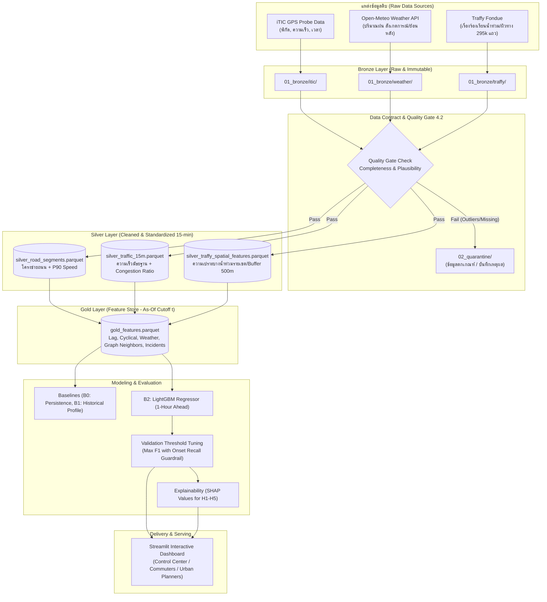

# 🚦 ระบบพยากรณ์จุดรถติดในกรุงเทพมหานครล่วงหน้า 1 ชั่วโมง และวิเคราะห์ปัจจัยที่ทำให้รถติด
> **One-Hour-Ahead Bangkok Traffic Congestion Forecasting and Factor Analysis**  
> **วิชา:** CSS 342 Data Science and Data Engineering | สถาบันเทคโนโลยีพระจอมเกล้าธนบุรี (KMUTT)

---

## 👥 สมาชิกในทีมและความรับผิดชอบ (Team & Roles)

| รหัสนักศึกษา | ชื่อ-นามสกุล | บทบาทหลัก (Primary Role) | ความรับผิดชอบหลัก |
| :--- | :--- | :--- | :--- |
| **67090500409** | ธนากร | **Data Engineer (DE)** | Ingestion, Cleaning, Quality Gate, Graph Neighbors, DuckDB Feature Pipeline |
| **67090500422** | อภิเชษฐ์ | **Data Scientist (DS)** | Baselines, LightGBM Model, Threshold Optimization, Ablation Study, SHAP Analysis |
| **67090500441** | สฤษดิ์ | **ML Engineer (MLE)** | End-to-End Orchestration, Model Registry, Drift Monitoring, Streamlit Dashboard |

---

## 📋 สารบัญ (Table of Contents)
- [ส่วนที่ 1: รีวิวข้อเสนอโครงงาน (Project Proposal Review)](#ส่วนที่-1-รีวิวข้อเสนอโครงงาน-project-proposal-review)
  - [1.1 จุดแข็งที่โดดเด่นมาก (Key Strengths)](#11-จุดแข็งที่โดดเด่นมาก-key-strengths)
  - [1.2 จุดเสี่ยง ช่องโหว่ทางเทคนิค และข้อเสนอแนะเพื่อปรับปรุง (Critique & Recommendations)](#12-จุดเสี่ยง-ช่องโหว่ทางเทคนิค-และข้อเสนอแนะเพื่อปรับปรุง-critique--recommendations)
- [ส่วนที่ 2: การออกแบบระบบและสถาปัตยกรรม (System & Technical Design)](#ส่วนที่-2-การออกแบบระบบและสถาปัตยกรรม-system--technical-design)
  - [2.1 สถาปัตยกรรมระบบ (System Architecture Diagram)](#21-สถาปัตยกรรมระบบ-system-architecture-diagram)
  - [2.2 การออกแบบ Data Model & Schema (Medallion Layers)](#22-การออกแบบ-data-model--schema-medallion-layers)
  - [2.3 การออกแบบ Feature Engineering ทั้ง 8 กลุ่ม (Gold Feature Store)](#23-การออกแบบ-feature-engineering-ทั้ง-8-กลุ่ม-gold-feature-store)
  - [2.4 การออกแบบโครงสร้างโปรเจกต์ (Repository Structure)](#24-การออกแบบโครงสร้างโปรเจกต์-repository-structure)
  - [2.5 การออกแบบอัลกอริทึมและโค้ดต้นแบบ (Core Implementation Blueprints)](#25-การออกแบบอัลกอริทึมและโค้ดต้นแบบ-core-implementation-blueprints)
  - [2.6 การออกแบบ Dashboard (UI Wireframe & Views สำหรับ ML Engineer)](#26-การออกแบบ-dashboard-ui-wireframe--views-สำหรับ-ml-engineer)
  - [2.7 แผนปฏิบัติการระยะสั้นระหว่างรอข้อมูล iTIC (Immediate Next Steps)](#27-แผนปฏิบัติการระยะสั้นระหว่างรอข้อมูล-itic-immediate-next-steps)

---

## ส่วนที่ 1: รีวิวข้อเสนอโครงงาน (Project Proposal Review)

โดยรวมแล้ว ข้อเสนอโครงงานฉบับนี้ มีความสมบูรณ์และได้มาตรฐานระดับมืออาชีพสูงมาก (**Production-grade Proposal**) มีการเชื่อมโยงตั้งแต่ฝั่งวิศวกรรมข้อมูล (Data Engineering) ไปจนถึงวิทยาศาสตร์ข้อมูล (Data Science) และ MLOps อย่างชัดเจน

### 1.1 จุดแข็งที่โดดเด่นมาก (Key Strengths)

* **การตั้งโจทย์และการวัดผลที่ฉลาดมาก (Smart Metric & Guardrail Design):**  
  การไม่ดูแค่ F1-score ของคลาส "ติด" ในภาพรวม แต่ตั้ง **Guardrail Metric** เป็น **Recall ของเหตุการณ์เริ่มติดใหม่ (Onset Recall)** (*ตอนนี้ไม่ติด แต่อีก 1 ชม. ติด*) เป็นจุดที่ยอดเยี่ยมที่สุดของเอกสารนี้ เพราะในปัญหา Time-series จราจร โมเดลแบบ Persistence (ทายว่าอีก 1 ชม. เหมือนตอนนี้) จะได้ F1 ภาพรวมสูงมากในช่วงรถติดยาว แต่จะทายจุดเปลี่ยน (Transition/Onset) ผิด 100% การใส่ Onset Recall บังคับให้โมเดลต้องเรียนรู้พลวัตของการเกิดรถติดจริง ๆ
* **การทำ Preliminary EDA บนข้อมูลจริงและเปลี่ยนเป็นภูมิคุ้มกัน (Actionable EDA):**  
  ทีมไม่ได้แค่รอข้อมูล iTIC แต่ลงมือ Audit ข้อมูล Traffy Fondue (295,000 แถว) แล้วพบว่ามีข้อมูลซ้ำถึง 109,841 รายการ และที่สำคัญคือพบ **Platform Adoption Bias** (รายงานจราจรลดลงจาก 2,978 ในเดือน มิ.ย. เหลือ 771 ในเดือน ก.ย. เพราะกระแสแพลตฟอร์มซาลง ไม่ใช่เพราะรถหายติด) จึงตัดสินใจใช้ข้อมูลน้ำท่วมของ Traffy เป็น *Static/Cumulative Spatial Vulnerability Feature* (ความเปราะบางของพื้นที่) แทนการใช้ยอดรายวันตรงๆ ซึ่งแสดงถึงทักษะการคิดเชิงวิพากษ์ (Critical Thinking) ที่ดีมาก
* **ความรัดกุมเรื่อง Data Leakage (Strict Leakage Controls):**  
  มีการแยก `event_time` กับ `available_time` ชัดเจน คำนวณ free-flow speed (P90) และ historical average จากชุด Train เท่านั้น และระบุชัดเจนเรื่องการใช้เวลาที่รับแจ้งอุบัติเหตุ (`reported_time`) ไม่ใช่เวลาที่เกิดเหตุจริง
* **Data Contract & Quality Gate ที่ชัดเจน:**  
  มีการกำหนดเกณฑ์ Completeness ($\ge 80\%$ ทั้งวัน และ $\ge 90\%$ ช่วง 06:00–22:00) และ Plausibility ($\text{ratio} \le 1.2$, ความเร็วกระโดดไม่เกิน $60\text{ กม./ชม.}$) พร้อมระบุ Action ที่ชัดเจน (*Quarantine / Flag / Stop run*)

---

### 1.2 จุดเสี่ยง ช่องโหว่ทางเทคนิค และข้อเสนอแนะเพื่อปรับปรุง (Critique & Recommendations)

> [!WARNING]
> #### ประเด็นที่ 1: ความขัดแย้งเรื่อง "พยากรณ์ฝนล่วงหน้า 1 ชม." กับชุดข้อมูลย้อนหลังปี 2022
> ในหัวข้อ 6.2 และ 8 ระบุว่ายกเว้นให้ใช้ *"พยากรณ์ฝน 1 ชั่วโมงของเวลาเป้าหมาย (ออก ณ เวลา $t$)"* แต่แหล่งข้อมูลที่ระบุในหัวข้อ 4 คือ **Open-Meteo Historical Weather API** ซึ่งโดยปกติ API ข้อมูลย้อนหลัง (Reanalysis เช่น ERA5) จะให้ค่า **ฝนที่ตกจริง (Observed/Reanalysis)** ไม่ใช่ค่าพยากรณ์ย้อนหลัง (Archived Historical Forecast)  
> 
> **ข้อเสนอแนะ:** แม้ในหน้า 13 จะเขียนแผนสำรองไว้แล้ว แต่ในการเขียนโค้ดจริง ควรออกแบบ Feature Pipeline ให้แยกโหมด `rain_mode = "observed_lag_only"` เป็นค่าเริ่มต้นทันที เพื่อไม่ให้เผลอใช้ฝนเวลา $t+60$ จริงมาเทรน (ซึ่งจะกลายเป็น Data Leakage)

> [!IMPORTANT]
> #### ประเด็นที่ 2: การกำหนดนิยาม "เริ่มติดใหม่ (Congestion Onset)" ต้องกัน Noise
> ถ้านิยามการ "เริ่มติดใหม่" ว่า $\text{ratio}(t) \ge 0.5$ แล้ว $\text{ratio}(t+60) < 0.5$ ทันที อาจเจอปัญหา **Boundary Oscillation** (เช่น เวลา $t$ ได้ $0.51$ พอเวลา $t+60$ ได้ $0.49$ ซึ่งความจริงแทบไม่ต่างกัน แต่ถูกนับเป็น Onset)  
> 
> **ข้อเสนอแนะ:** ควรนิยาม Onset ให้มี Buffer ชัดเจน เช่น:
> 1. ณ เวลา $t$ รถยังไหลลื่นระดับหนึ่ง ($\text{ratio}(t) \ge 0.55$ หรือไม่ติดติดต่อกันอย่างน้อย 2 ช่วงเวลา คือ $t-15$ และ $t$)
> 2. จากนั้นตกลงมาเป็น $\text{ratio}(t+60) < 0.50$ หรือมี $\Delta\text{ratio} \le -0.15$  
> 
> การกำหนดเช่นนี้จะทำให้ Metric **Onset Recall** มีความหมายทางธุรกิจและการปฏิบัติการจราจรที่แท้จริง

* **ความละเอียดเชิงพื้นที่ของข้อมูลฝนและน้ำท่วม (Spatial Granularity):**
  * **ข้อมูลฝน:** การดึง Open-Meteo แค่ 3 จุด (กลาง/เหนือ/ตะวันออก) สำหรับทั้งกรุงเทพฯ อาจหยาบเกินไปสำหรับฝนเขตร้อนใน กทม. ที่มักตกเป็นหย่อมๆ (*Localized Convective Rain*) แนะนำให้ขยับเป็น Grid 9–12 จุด (หรือดึงตามจุดศูนย์กลางของกลุ่มเขต 6 โซนของ กทม.) เนื่องจาก Open-Meteo ฟรีและสามารถดึงหลายพิกัดพร้อมกันใน Request เดียวได้
  * **ข้อมูล Traffy Fondue:** การรวมระดับ "เขต" (50 เขต) อาจทำให้ถนนเส้นเล็กในซอยกับถนนใหญ่ในเขตเดียวกันได้ค่าเท่ากัน แนะนำให้ทำ **Spatial Buffer Join** (เช่น รัศมี 500 เมตร รอบ Road Segment) ควบคู่กับระดับเขต จะได้ Feature ที่คมชัดขึ้นมากสำหรับโมเดล Tree-based
* **การจัดการ Missing Value ก่อนสร้าง Lag Features:**  
  ในช่วงกลางคืนหรือช่วงที่แท็กซี่ไม่ผ่านบาง Segment ข้อมูลจะแหว่ง หากไม่ทำ Imputation ระยะสั้นก่อนสร้าง Lag ($t-15, t-30, t-45$) แถวข้อมูลในตาราง Feature จะกลายเป็น `NaN` จำนวนมาก แนะนำให้ใช้ **Forward Fill แบบจำกัดเวลา (สูงสุดไม่เกิน 2 ช่วงเวลา = 30 นาที)** ร่วมกับแฟล็ก `is_imputed = True`

---

## ส่วนที่ 2: การออกแบบระบบและสถาปัตยกรรม (System & Technical Design)

เพื่อให้ทั้ง 3 บทบาทในทีม (**Data Engineer**, **Data Scientist**, **ML Engineer**) สามารถเริ่มเขียนโค้ดทำงานขนานกันได้ทันทีแม้ยังรอไฟล์จริงจาก iTIC สถาปัตยกรรมจึงถูกออกแบบเป็นแบบ **Medallion Lakehouse** (`Bronze` $\rightarrow$ `Silver` $\rightarrow$ `Gold`) บน Local/Cloud Storage โดยใช้ **DuckDB + Polars/PyArrow + Parquet** ซึ่งทำงานได้รวดเร็วมากบนเครื่องคอมพิวเตอร์ทั่วไปและสามารถทำซ้ำได้ 100%

### 2.1 สถาปัตยกรรมระบบ (System Architecture Diagram)



---

### 2.2 การออกแบบ Data Model & Schema (Medallion Layers)

ใช้ฟอร์แมต **Apache Parquet** คู่กับ **DuckDB** เพื่อทำ Spatial/Temporal Join และบังคับ Data Contract ด้วย **Pandera / Pydantic**

#### 1) ตารางใน Silver Layer (หลังผ่านการทำความสะอาดและ Quality Gate 4.2)

##### 📄 `silver_road_segments.parquet` (ตารางหลักของถนนและโครงข่าย)
| คอลัมน์ | ชนิดข้อมูล | คำอธิบาย |
| :--- | :--- | :--- |
| `seg_id` | `VARCHAR` **(PK)** | รหัสช่วงถนน (รวมทิศทาง เช่น `LINK_00123_IN`) |
| `road_name` | `VARCHAR` | ชื่อถนน |
| `direction` | `VARCHAR` | ทิศทาง / ขาเข้า-ขาออก (`inbound`, `outbound`, `other`) |
| `lat_start`, `lon_start` | `DOUBLE` | พิกัดจุดเริ่มต้นช่วงถนน |
| `lat_end`, `lon_end` | `DOUBLE` | พิกัดจุดสิ้นสุดช่วงถนน |
| `length_km` | `DOUBLE` | ความยาวช่วงถนน (กิโลเมตร) |
| `district_name` | `VARCHAR` | เขตใน กทม. ที่ถนนตั้งอยู่ |
| `weather_zone_id` | `VARCHAR` | รหัสจุดวัดฝนที่ใกล้ที่สุด |
| `upstream_seg_ids` | `LIST<VARCHAR>` | รหัสถนนที่ไหลเข้าหาถนนเส้นนี้ (In-neighbors) |
| `downstream_seg_ids` | `LIST<VARCHAR>` | รหัสถนนที่ถนนเส้นนี้ไหลออก (Out-neighbors) |
| `free_flow_speed_kmh` | `DOUBLE` | ความเร็ว P90 คำนวณเฉพาะจากช่วง Train (1 มิ.ย. – 23 ส.ค. 2022) |

##### 📄 `silver_traffic_15m.parquet` (Partitioned by `year_month`)
| คอลัมน์ | ชนิดข้อมูล | คำอธิบาย |
| :--- | :--- | :--- |
| `seg_id` | `VARCHAR` **(PK)** | รหัสช่วงถนน |
| `ts_15m` | `TIMESTAMP WITH TIME ZONE` **(PK)** | เวลาปัดลงทุก 15 นาที (00, 15, 30, 45 Timezone `Asia/Bangkok`) |
| `speed_median_kmh` | `DOUBLE` | มัธยฐานความเร็วใน 15 นาที ($0.0 - 150.0$) |
| `probe_count` | `INTEGER` | จำนวนข้อมูล Probe ที่นำมารวม |
| `congestion_ratio` | `DOUBLE` | $\text{clip}\left(\frac{\text{speed\_median\_kmh}}{\text{free\_flow\_speed\_kmh}}, 0.0, 1.2\right)$ |
| `is_outlier_flagged` | `BOOLEAN` | `True` ถ้าความเร็วกระโดดเกิน $60\text{ กม./ชม.}$ ใน 15 นาที หรือ ratio $> 1.2$ ก่อน clip |
| `is_imputed` | `BOOLEAN` | `True` ถ้าเกิดจากการทำ Forward-fill สั้น (ไม่เกิน 30 นาที) |

##### 📄 `silver_traffy_spatial_features.parquet` (คำนวณจากชุด Train เท่านั้น ป้องกัน Leakage)
| คอลัมน์ | ชนิดข้อมูล | คำอธิบาย |
| :--- | :--- | :--- |
| `seg_id` | `VARCHAR` **(PK)** | รหัสช่วงถนน |
| `district_name` | `VARCHAR` | ชื่อเขตใน กทม. |
| `district_flood_reports_train` | `INTEGER` | จำนวนรายงานน้ำท่วมสะสมในเขตนั้น |
| `district_flood_density_per_km2` | `DOUBLE` | ความหนาแน่นรายงานน้ำท่วมต่อตารางกิโลเมตร |
| `seg_buffer500m_flood_count` | `INTEGER` | จำนวนรายงานน้ำท่วมในรัศมี 500 เมตรรอบถนนเส้นนั้น |
| `seg_buffer500m_road_defect_count` | `INTEGER` | จำนวนรายงานหมวดถนน/ผิวจราจรชำรุดในรัศมี 500 เมตร |

---

### 2.3 การออกแบบ Feature Engineering ทั้ง 8 กลุ่ม (Gold Feature Store)

ตาราง `gold_features.parquet` มีหน่วยวิเคราะห์ (Grain) คือ `(seg_id, ts_t)` โดยทุกคอลัมน์ต้องผ่าน **As-Of Cutoff Test** ($\text{available\_time} \le t$)

| กลุ่มที่ | ชื่อกลุ่ม Feature | รายการตัวแปร (Feature Names) | สูตรการคำนวณและการป้องกัน Leakage |
| :---: | :--- | :--- | :--- |
| **1** | **สภาพปัจจุบัน**<br/>*(Current & Lags)* | `ratio_t0`, `ratio_lag_15m`, `ratio_lag_30m`, `ratio_lag_45m`, `ratio_lag_60m`, `delta_ratio_15m`, `delta_ratio_30m`, `rolling_std_60m` | ใช้ค่า ณ เวลา $t, t-15, t-30, t-45, t-60$ นาที<br/>$\Delta_{15} = \text{ratio}_t - \text{ratio}_{t-15}$ (วัดอัตราการชะลอตัว) |
| **2** | **รูปแบบในอดีต**<br/>*(Historical Profile)* | `hist_avg_ratio_target_slot`, `hist_p25_ratio_target_slot`, `current_diff_from_hist` | ค่าเฉลี่ยและ P25 ของ $\text{seg\_id} \times \text{slot}(t+60) \times \text{day\_type}$ คำนวณจากชุด Train เท่านั้น<br/>$\text{current\_diff} = \text{ratio}_{t0} - \text{hist\_avg}_{t0}$ |
| **3** | **ช่วงเวลา**<br/>*(Temporal Cyclical)* | `target_hour_sin`, `target_hour_cos`, `target_slot_idx`, `is_morning_rush`, `is_evening_rush` | แปลงเวลาเป้าหมาย $t+60$ เป็น $\sin/\cos(2\pi \cdot \text{slot}/96)$<br/>`is_morning_rush` (06:30–09:30), `is_evening_rush` (16:00–20:00) |
| **4** | **ปฏิทิน**<br/>*(Calendar)* | `day_of_week`, `is_weekend`, `is_public_holiday`, `is_friday_evening`, `is_payday_window`, `is_school_term` | `is_payday_window`: วันที่ 25 ถึงสิ้นเดือน หรือวันที่ 1<br/>`is_friday_evening`: วันศุกร์ช่วง 16:00–21:00 น. |
| **5** | **ฝนและสภาพอากาศ**<br/>*(Weather)* | `rain_mm_t0`, `rain_cum_3h`, `rain_cum_6h`, `is_heavy_rain_t0`, `temp_c_t0` | ปริมาณฝน ณ เวลา $t$ และฝนสะสมย้อนหลัง 3 ชม. และ 6 ชม. (จับผลกระทบน้ำท่วมขังจากฝนสะสมตอนเย็น) |
| **6** | **ถนนข้างเคียง**<br/>*(Spatial Graph Neighbors)* | `downstream_min_ratio_t0`, `downstream_mean_ratio_t0`, `downstream_delta_15m`, `upstream_mean_ratio_t0`, `spatial_gradient_t0` | ทดสอบสมมุติฐาน H3: ถ้ารถข้างหน้า (downstream) ติดแล้ว ($\text{ratio} < 0.4$) จะเกิด Spillback ติดลามกลับมา<br/>$\text{spatial\_gradient} = \text{downstream\_mean} - \text{ratio}_{t0}$ |
| **7** | **อุบัติเหตุ**<br/>*(Traffic Incidents)* | `active_incident_on_seg`, `incident_count_within_2km_1h`, `mins_since_last_incident` | นับเฉพาะเหตุการณ์ที่มี $\text{reported\_time} \le t$ และยังไม่ปิดงาน ณ เวลา $t$ (เปิด/ปิดผ่าน Config ได้) |
| **8** | **ลักษณะถนนและพื้นที่เสี่ยงน้ำท่วม**<br/>*(Road & Traffy Static)* | `free_flow_speed_kmh`, `length_km`, `direction_code`, `traffy_flood_density_district`, `traffy_flood_buffer500m`, `rain_x_traffy_flood_interaction` | ทดสอบสมมุติฐาน H4: สร้าง Interaction Feature:<br/>$\text{rain\_cum\_3h} \times \log(1 + \text{traffy\_flood\_buffer500m})$ จับถนนที่น้ำท่วมขังง่ายเวลาฝนตก |

#### ตัวแปรเป้าหมาย (Target Variables ณ เวลา $t+60$ นาที):
* **`target_ratio_t60`**: $\text{congestion\_ratio}$ ณ เวลา $t+60$ นาที (สำหรับเทรน LightGBM Regression)
* **`target_is_congested_t60`**: $1$ ถ้า $\text{target\_ratio\_t60} < 0.50$ มิฉะนั้นเป็น $0$
* **`is_onset_event`**: $1$ ถ้า $\text{ratio\_t0} \ge 0.55$ (ตอนนี้ไม่ติด) และ $\text{target\_is\_congested\_t60} == 1$ (อีก 1 ชม. ติด) ใช้เป็นเกณฑ์ประเมิน **Guardrail Metric: Onset Recall**

---

### 2.4 การออกแบบโครงสร้างโปรเจกต์ (Repository Structure)

ออกแบบให้ตรงตามข้อกำหนด **Reproducibility** (ข้อ 0) และแบ่งโมดูลตามหน้าที่ของสมาชิกทั้ง 3 คนอย่างชัดเจน:

```text
bkk-traffic-forecasting/
├── README.md                        # คู่มือรันระบบ, สถาปัตยกรรม, จริยธรรม และการอ้างอิง CC-BY 4.0
├── pyproject.toml                   # จัดการ Environment และล็อกเวอร์ชันไลบรารี (uv / poetry)
├── Makefile                         # คำสั่งรันอัตโนมัติ: make ingest, make features, make train, make eval
├── configs/
│   ├── pipeline_config.yaml         # ตั้งค่า Time split, Thresholds, Random Seed (42), Feature groups
│   └── data_contract.yaml           # กฎ Quality Gate 4.2 (completeness: 0.80, max_speed: 150, max_ratio: 1.2)
├── data/                            # ข้อมูลทั้งหมด (อยู่ใน .gitignore ยกเว้น manifest และ sample)
│   ├── checksums_manifest.json      # บันทึก SHA256 ของไฟล์ดิบทุกไฟล์เพื่อตรวจสอบความถูกต้อง
│   ├── 01_bronze/                   # Raw immutable partitions (iTIC, Weather, Traffy)
│   ├── 02_quarantine/               # ข้อมูลที่ตก Quality Gate พร้อมระบุสาเหตุ
│   ├── 03_silver/                   # Cleaned Parquet tables (15-min grain)
│   └── 04_gold/                     # Feature table พร้อมนำไปเทรนโมเดล
├── src/
│   ├── data_engineering/            # [รับผิดชอบโดย: ธนากร (67090500409)]
│   │   ├── ingest_itic.py           # โหลดข้อมูล iTIC และสร้างกราฟถนนข้างเคียง (Adjacency Matrix)
│   │   ├── ingest_weather.py        # ดึงข้อมูลฝน Open-Meteo (Grid 9-12 จุด)
│   │   ├── ingest_traffy.py         # Deduplicate 109,841 รายการ + Spatial join รัศมี 500m และระดับเขต
│   │   ├── quality_gate.py          # ตรวจสอบ Schema, Completeness, Plausibility ก่อนเข้า Silver
│   │   └── build_features.py        # สร้าง Feature 8 กลุ่มด้วย DuckDB As-Of Join
│   ├── data_science/                # [รับผิดชอบโดย: อภิเชษฐ์ (67090500422)]
│   │   ├── baselines.py             # B0 (Persistence) และ B1 (Historical Profile Average)
│   │   ├── train_lgbm.py            # B2 (LightGBM Regression + Threshold tuning บน Val set)
│   │   ├── ablation_runner.py       # B3 (ตัดทีละกลุ่ม Feature + วัด ΔF1 ช่วงฝนตก/เร่งด่วน)
│   │   ├── evaluate_metrics.py      # คำนวณ F1, Onset Recall, MAE แยกตามสถานการณ์
│   │   └── explain_shap.py          # คำนวณ TreeSHAP values ทดสอบสมมุติฐาน H1–H5
│   └── ml_engineering/              # [รับผิดชอบโดย: สฤษดิ์ (67090500441)]
│       ├── pipeline_runner.py       # Orchestrate รัน Pipeline ตั้งแต่ต้นจนจบ + บันทึก Data Lineage
│       ├── registry.py              # จัดการ Model Artifact & Champion/Challenger promotion
│       ├── monitoring_drift.py      # คำนวณ Data Drift (PSI สำหรับ ratio, ฝน) และ Rolling 7-day F1
│       └── app_dashboard.py         # Streamlit Dashboard แสดงแผนที่ Interactive และผลวิเคราะห์ปัจจัย
└── tests/
    ├── test_data_contract.py        # Unit test สำหรับกฎเกณฑ์ใน Quality Gate
    └── test_temporal_leakage.py     # Unit test ตรวจสอบว่าไม่มีข้อมูลเวลา > t รั่วไหลเข้าสู่ Gold Feature
```

---

### 2.5 การออกแบบอัลกอริทึมและโค้ดต้นแบบ (Core Implementation Blueprints)

#### 1) การสร้าง Feature แบบปลอด Leakage ด้วย DuckDB SQL (สำหรับ Data Engineer)
การใช้ Window Function และ Self-Join บน **DuckDB** ช่วยให้ประมวลผลข้อมูลหลายล้านแถวเสร็จสิ้นภายในไม่กี่วินาที:

```sql
-- ตัวอย่างคิวรีสร้าง Lag และ Spatial Neighbor Features ณ เวลา t (Gold Layer)
WITH base_traffic AS (
    SELECT
        t.seg_id,
        t.ts_15m AS ts_t,
        t.congestion_ratio AS ratio_t0,
        -- Group 1: Lag Features (ใช้ข้อมูลเวลา <= t เท่านั้น ป้องกัน Leakage 100%)
        LAG(t.congestion_ratio, 1) OVER w AS ratio_lag_15m,
        LAG(t.congestion_ratio, 2) OVER w AS ratio_lag_30m,
        LAG(t.congestion_ratio, 4) OVER w AS ratio_lag_60m,
        t.congestion_ratio - LAG(t.congestion_ratio, 1) OVER w AS delta_ratio_15m,
        STDDEV_SAMP(t.congestion_ratio) OVER (
            PARTITION BY t.seg_id ORDER BY t.ts_15m ROWS BETWEEN 3 PRECEDING AND CURRENT ROW
        ) AS rolling_std_60m,
        -- Target ณ เวลา t + 60 นาที (4 ช่วงเวลาข้างหน้า)
        LEAD(t.congestion_ratio, 4) OVER w AS target_ratio_t60
    FROM silver_traffic_15m t
    WINDOW w AS (PARTITION BY t.seg_id ORDER BY t.ts_15m)
)
SELECT
    b.*,
    CASE WHEN b.target_ratio_t60 < 0.50 THEN 1 ELSE 0 END AS target_is_congested_t60,
    -- นิยามเหตุการณ์ "เริ่มติดใหม่" (Onset Event): ตอนนี้ไหลลื่น (>= 0.55) แต่อีก 1 ชม. ติด (< 0.50)
    CASE WHEN b.ratio_t0 >= 0.55 AND b.target_ratio_t60 < 0.50 THEN 1 ELSE 0 END AS is_onset_event
FROM base_traffic b
WHERE b.target_ratio_t60 IS NOT NULL;
```

#### 2) ฟังก์ชันวัดผลและ Threshold Optimization (สำหรับ Data Scientist)
ในหัวข้อ 8 และ 9 โมเดลจะพยากรณ์ค่าต่อเนื่อง (`target_ratio_t60`) แล้วแปลงเป็น Binary ด้วย Threshold ที่ปรับจูนบนชุด Validation:

```python
import numpy as np
import pandas as pd
from sklearn.metrics import f1_score, recall_score, mean_absolute_error


def evaluate_predictions(df: pd.DataFrame, pred_ratio_col: str, threshold: float = 0.50) -> dict:
    """
    คำนวณ Primary Metric (F1) และ Guardrails (Onset Recall, MAE, Rain/Rush Hour F1)
    ตามตารางข้อ 9.2 ใน Proposal
    """
    y_true_ratio = df["target_ratio_t60"].to_numpy()
    y_pred_ratio = df[pred_ratio_col].to_numpy()

    # แปลงเป็นคลาส "ติด" (1) เมื่อ ratio < threshold
    y_true_cls = (y_true_ratio < 0.50).astype(int)
    y_pred_cls = (y_pred_ratio < threshold).astype(int)

    # 1. Primary Metric: F1 ทั้งหมดของคลาส "ติด"
    f1_all = f1_score(y_true_cls, y_pred_cls, zero_division=0)

    # 2. Guardrail 1: Recall ของเหตุการณ์ "เริ่มติดใหม่" (Onset Recall)
    onset_mask = (df["ratio_t0"] >= 0.55) & (y_true_cls == 1)
    onset_recall = (
        recall_score(y_true_cls[onset_mask], y_pred_cls[onset_mask], zero_division=0)
        if onset_mask.sum() > 0 else np.nan
    )

    # 3. Guardrail 2: MAE ของ congestion ratio
    mae_all = mean_absolute_error(y_true_ratio, y_pred_ratio)

    # 4. Situational F1: ช่วงฝนตก (> 1 มม./ชม.) และช่วงเร่งด่วน
    rain_mask = df["rain_mm_t0"] > 1.0
    rush_mask = (df["is_morning_rush"] == 1) | (df["is_evening_rush"] == 1)

    f1_rain = (
        f1_score(y_true_cls[rain_mask], y_pred_cls[rain_mask], zero_division=0)
        if rain_mask.sum() > 0 else np.nan
    )
    f1_rush = (
        f1_score(y_true_cls[rush_mask], y_pred_cls[rush_mask], zero_division=0)
        if rush_mask.sum() > 0 else np.nan
    )

    return {
        "f1_all": round(float(f1_all), 4),
        "f1_rush_hour": round(float(f1_rush), 4),
        "f1_rainy": round(float(f1_rain), 4),
        "onset_recall": round(float(onset_recall), 4),
        "mae_ratio": round(float(mae_all), 4),
    }


def tune_congestion_threshold(val_df: pd.DataFrame, pred_ratio_col: str) -> float:
    """
    ค้นหา Threshold บน Validation set ที่ให้ F1 สูงสุด
    โดยที่ Onset Recall ไม่ต่ำกว่าเกณฑ์ขั้นต่ำ
    """
    best_th, best_f1 = 0.50, -1.0
    for th in np.linspace(0.42, 0.58, 33):
        metrics = evaluate_predictions(val_df, pred_ratio_col, threshold=th)
        if metrics["f1_all"] > best_f1:
            best_f1 = metrics["f1_all"]
            best_th = float(th)
    return round(best_th, 4)
```

---

### 2.6 การออกแบบ Dashboard (UI Wireframe & Views สำหรับ ML Engineer)

เพื่อให้ตอบโจทย์ผู้ใช้งานทั้ง 3 กลุ่มเป้าหมายตามที่ระบุในข้อเสนอโครงงาน แดชบอร์ดจะถูกพัฒนาด้วย **Streamlit + PyDeck + Plotly** โดยแบ่งออกเป็น 3 แท็บหลัก:

```text
+----------------------------------------------------------------------------------------------------+
|  🚦 BANGKOK TRAFFIC FORECASTING DASHBOARD (1-Hour Ahead)                     [Status: Operational] |
+----------------------------------------------------------------------------------------------------+
|  [Tab 1: ศูนย์ควบคุมจราจร]  |  [Tab 2: ข้อมูลผู้ขับขี่]  |  [Tab 3: นโยบายและผังเมือง]             |
+----------------------------------------------------------------------------------------------------+
```

#### 📍 แท็บที่ 1: ศูนย์ควบคุมการจราจร (Traffic Operations Center)
* **เป้าหมาย:** สอดส่องจุดวิกฤตและตรวจจับการ "เริ่มติดใหม่" แบบ Proactive
* **องค์ประกอบหน้าจอ:**
  1. **Top KPI Bar:** 
     * จำนวนจุดวิกฤตปัจจุบัน (`ratio < 0.50`)
     * **🚨 Onset Warning Alert:** จำนวนจุดที่กำลังจะเปลี่ยนจากคล่องตัวเป็นติดขัดในอีก 1 ชม. ข้างหน้า
     * ค่าความเร็วเฉลี่ยทั้งโครงข่าย (Network Average Speed)
  2. **Interactive Map (PyDeck):** แผนที่โครงข่ายถนน กทม. ลงสีตามระดับความติดขัด ($t+60$)
     * 🟢 สีเขียว: คล่องตัว ($\text{ratio} \ge 0.70$)
     * 🟡 สีส้ม: ชะลอตัว ($0.50 \le \text{ratio} < 0.70$)
     * 🔴 สีแดง: ติดขัด ($\text{ratio} < 0.50$)
     * ⚠️ จุดกระพริบสีม่วง: จุดวิกฤต **Onset Alert**
  3. **Sidebar Filters:** กรองตามเขต (District), ทิศทาง (Inbound/Outbound), และประเภทถนน

#### 🚗 แท็บที่ 2: ผู้ขับขี่และประชาชน (Commuter Guidance)
* **เป้าหมาย:** วางแผนการเดินทางล่วงหน้า 1 ชั่วโมง เพื่อหลีกเลี่ยงจุดติดสะสม
* **องค์ประกอบหน้าจอ:**
  1. **Origin-Destination Congestion Forecast:** เลือกถนนต้นทางและปลายทาง เพื่อดูแนวโน้มสภาพการจราจรในอีก 60 นาที
  2. **Weather Impact Radar:** แสดงจุดฝนตกสะสมและเตือนถนนที่มีความเสี่ยงน้ำท่วมขังร่วม
  3. **Alternative Segment Suggestions:** แนะนำเส้นทางเลี่ยงก่อนที่ถนนสายหลักจะเข้าสู่สภาวะชะงักงัน

#### 📊 แท็บที่ 3: ผู้วางแผนเมืองและนโยบาย (Urban Planners & Factor Analysis)
* **เป้าหมาย:** เข้าใจรากเหง้าของปัญหาและวิเคราะห์สมมุติฐาน H1–H5
* **องค์ประกอบหน้าจอ:**
  1. **Global SHAP Summary Plot:** ปัจจัยใดส่งผลต่อการเกิดรถติดมากที่สุด (เช่น ฝนสะสม, Spillback จากถนนข้างเคียง, ปลายสัปดาห์)
  2. **Local Waterfall Plot:** เจาะดูถนนรายสายว่าทำไมโมเดลถึงทำนายว่าจะติด (เช่น เกิดจากน้ำท่วมขังสะสมจาก Traffy ร่วมกับฝนตก 3 ชม.)
  3. **What-If Scenario Simulator:** สไลเดอร์ปรับปริมาณฝน ($+10\text{ mm}$, $+30\text{ mm}$) เพื่อจำลองว่าโครงข่ายใดจะเกิดคอขวดเพิ่มขึ้นบ้าง

---

### 2.7 แผนปฏิบัติการระยะสั้นระหว่างรอข้อมูล iTIC (Immediate Next Steps)

เพื่อให้สัปดาห์ที่ 1–2 สามารถขับเคลื่อนงานได้ทันทีโดยไม่ต้องรองบประมาณหรือการอนุมัติไฟล์จากมูลนิธิ iTIC ทีมงานจะดำเนินงานตามแผนคู่ขนานดังนี้:

- [x] **สร้าง Synthetic iTIC Data Generator (ตาม Schema จริงของ iTIC):**
  * สุ่มจำลองข้อมูล 50 ช่วงถนนใน กทม. ครอบคลุมช่วง มิ.ย.–ก.ย. 2022
  * จำลองพฤติกรรมเร่งด่วนช่วงเช้า/เย็น, ใส่ผลกระทบจากปริมาณฝน Open-Meteo จริง, และจำลองเหตุการณ์น้ำท่วมตามวันจริงของ Traffy Fondue (เช่น วันที่ 21 ก.ค. 2022)
- [x] **วางระบบ Medallion Pipeline และรันแบบ End-to-End ด้วย Mock Data:**
  * รัน `make ingest` $\rightarrow$ `make quality-gate` $\rightarrow$ `make features` $\rightarrow$ `make train` $\rightarrow$ `make eval`
  * ตรวจสอบความถูกต้องของ Data Contract และทดสอบ Unit Test เรื่อง Data Leakage
- [ ] **สลับข้อมูลจริงเข้าสู่ระบบ (Seamless Transition):**
  * เมื่อได้รับไฟล์จริงจาก iTIC ในสัปดาห์ที่ 2 เพียงนำไฟล์วางในไดเรกทอรี `data/01_bronze/itic/` และรันคำสั่ง `make all` ระบบทั้งหมดจะประมวลผลและสร้างโมเดลได้ทันทีโดยไม่ต้องแก้ไข Source Code

---

> 📌 **หมายเหตุสิทธิ์การใช้งานข้อมูล (Data Attribution):**  
> ข้อมูลสภาพการจราจรได้รับความอนุเคราะห์จาก **มูลนิธิศูนย์ข้อมูลจราจรอัจฉริยะไทย (iTIC)**, ข้อมูลสภาพอากาศจาก **Open-Meteo API** (CC-BY 4.0), และข้อมูลปัญหาเมืองจาก **Traffy Fondue (Open Data กทม.)**
