# 🚦 Bangkok Traffic Congestion — Exploratory Data Analysis (DuckDB + Seaborn)

> **วิชา:** CSS 342 Data Science and Data Engineering (KMUTT)  
> **Branch:** `feature/eda`  
> **แหล่งข้อมูลหลัก:** `data/bkk_traffic.duckdb` — ข้อมูลจราจรจริง iTIC (ระดับ 15 นาที) ผสานสภาพอากาศ Open-Meteo, เรื่องร้องเรียนน้ำท่วม/ถนน Traffy Fondue และปฏิทิน ธปท. (**1 มิ.ย. – 30 ก.ย. 2022**)

---

## 📌 ภาพรวมข้อมูล (Dataset Snapshot)

| ตัวชี้วัด | ค่าจากฐานข้อมูล `bkk_traffic.duckdb` |
| :--- | :---: |
| **จำนวนระเบียนระดับช่วงถนน (15 นาที)** | **`23,840,561`** แถว (`gold.merged_segment_15m`) |
| **จำนวนระเบียนระดับเขต (15 นาที)** | **`585,600`** แถว (`gold.merged_district_15m`) |
| **ความครอบคลุมเชิงพื้นที่** | **`4,068`** ช่วงถนน | ครบทั้ง **`50` เขตกรุงเทพฯ** |
| **ช่วงเวลาข้อมูล** | **`122 วัน`** (`2022-06-01` ถึง `2022-09-30`, ฤดูมรสุมเต็มรูปแบบ) |
| **ความเร็วเฉลี่ย / มัธยฐานทั้ง กทม.** | **`37.97 km/h`** / **`36.00 km/h`** (`IQR: 21.5 – 50.0 km/h`) |
| **สัดส่วนเวลารถติดเฉลี่ย (`ratio < 0.50`)** | **`23.09%`** (เกิด **New Onset +1 ชม.** `2.17 ล้าน` เหตุการณ์) |

---

## ⚡ วิธีติดตั้งและรันใช้งาน (Quickstart — 3 ขั้นตอน)

```powershell
# 1. ติดตั้งไลบรารีที่จำเป็น (7 แพ็กเกจหลัก)
pip install -r requirements.txt

# 2. วางไฟล์ฐานข้อมูล DuckDB ไว้ที่
#    data/bkk_traffic.duckdb

# 3. รันสคริปต์สร้างกราฟทั้งหมด 12 รูป + หน้าเว็บดูกราฟรวม HTML + สรุปสถิติ JSON (~15 วินาที)
python eda.py
```

```powershell
# คำสั่งเสริม
python eda.py --list      # แสดงรายการกราฟทั้ง 12 รูป
python eda.py 1 12        # เลือกรันเฉพาะบางกราฟ (เร็ว ~2–3 วินาที)
```

> 🌐 **ดูกราฟทั้งหมดในหน้าเว็บเดียว:** เปิดไฟล์ `outputs/eda/eda_report.html` ในเบราว์เซอร์ได้เลย

---

## 🔥 ไฮไลต์: ทำไมรถถึงติดในกรุงเทพฯ? (6 กลไกต้นตอหลักจากข้อมูลจริง 23.84M แถว)

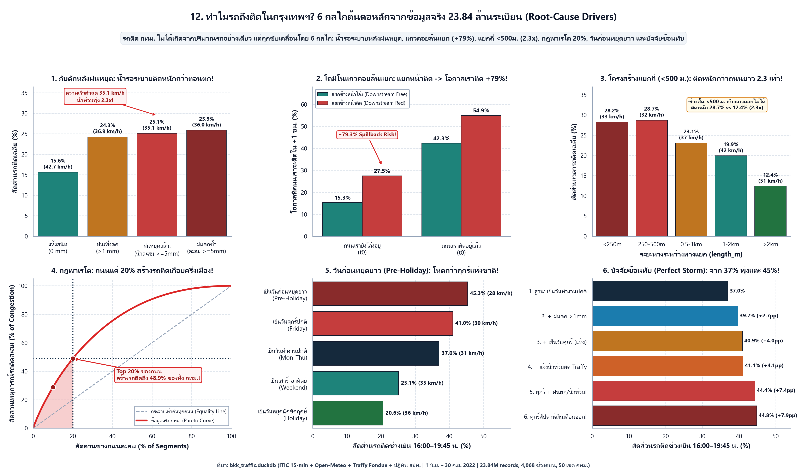

1. **กับดักหลังฝนหยุด (Post-Rain Waterlogging Trap):** เมื่อฝนหยุดตกแล้ว (`0 mm`) แต่มีฝนสะสม 3 ชม. `>= 5 mm` รถติดหนักถึง **`25.1%`** ความเร็วร่วงต่ำสุดในทุกสภาวะที่ **`35.1 km/h`** และรายงานน้ำท่วมพุ่ง **`2.3 เท่า`** สูงกว่าตอนฝนกำลังตกใหม่ๆ
2. **โดมิโนแถวคอยล้นแยก (Downstream Spillback):** แม้ถนนเรายังโล่งอยู่ แต่ถ้าแยกข้างหน้า (ปลายน้ำ) เริ่มติด โอกาสที่เราจะติดในอีก 1 ชม. พุ่งขึ้น **`+79.3%`** (`15.3%` $\rightarrow$ `27.5%`)
3. **โครงสร้างแยกถี่ (`< 500 ม.`):** ช่วงถนนสั้นที่มีระยะห่างทางแยกไม่ถึง 500 เมตร ติดหนักกว่าถนนยาว (`> 2 กม.`) ถึง **`2.3 เท่า`** (`28.7%` vs `12.4%`)
4. **กฎพาเรโต (Pareto Law):** ถนนเพียง **`20%` แรก** ของกรุงเทพฯ เป็นต้นตอของเหตุการณ์รถติดถึง **`48.9%` (เกือบครึ่งเมือง!)**
5. **วันก่อนหยุดยาว (Pre-Holiday Exodus):** เย็นวันก่อนหยุดยาว 3+ วัน ติดหนักถึง **`45.3%`** (`28 km/h`) โหดกว่าเย็นวันศุกร์ปกติ (`41.0%`) และร่วงลงเกินครึ่งในวันหยุดจริง (`20.6%`)
6. **ปัจจัยซ้อนทับ (Perfect Storm):** เย็นวันทำงานปกติ (`37.0%`) $\rightarrow$ ฝนตก (`39.7%`) $\rightarrow$ เย็นศุกร์ (`40.9%`) $\rightarrow$ น้ำท่วมสด (`41.1%`) $\rightarrow$ **ศุกร์ + ฝน/น้ำท่วม (`44.4%`)** $\rightarrow$ **ศุกร์สัปดาห์เงินเดือนออก (`44.8%`)**

---

## 📊 แกลเลอรีกราฟวิเคราะห์เชิงสำรวจทั้งหมด (Visual EDA Gallery)

### 1. มิติเชิงพื้นที่: แผนที่กรุงเทพฯ และความเหลื่อมล้ำ 50 เขต

#### 01. แผนที่ฐาน กทม. (Baseline): จุดรถติดสะสม & ผลกระทบจากฝนทั้ง 4,068 ช่วงถนน
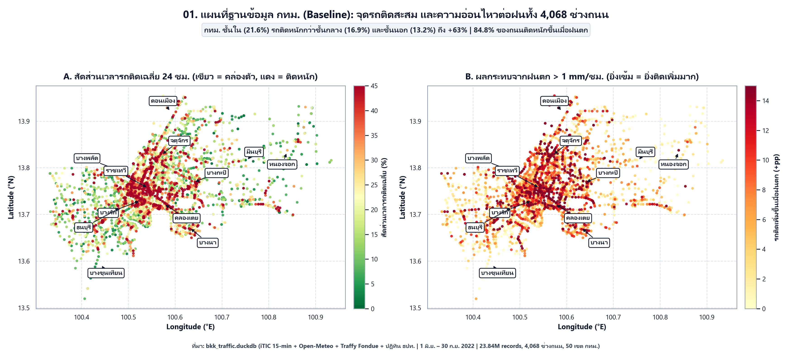
* **กทม. ชั้นใน (21 เขต)** ติดหนักกว่า **ชั้นนอก (11 เขต)** ถึง **`+63.1%`** (`21.6%` vs `13.2%`) และ **`84.8%`** ของถนนทั้ง 4,068 ช่วงแย่ลงเมื่อฝนตก (`> 1 mm/ชม.`)

#### 02. แผนที่เปรียบเทียบชั่วโมงเร่งด่วนวันทำงาน: เช้า (07–09 น.) vs เย็น (17–19 น.)
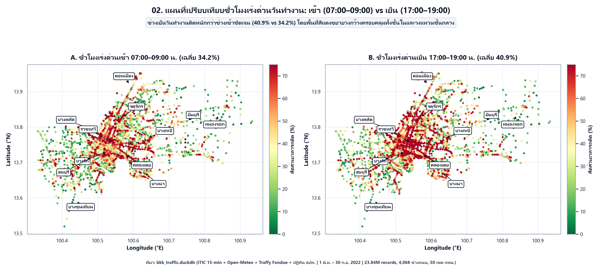
* ช่วงเย็นวันทำงาน (**`40.9%`**) ติดหนักและขยายวงกว้างกว่าช่วงเช้า (**`34.2%`**) ชัดเจน โดยเฉพาะแนวสุขุมวิท–รัชดา–พหลโยธิน–ลาดพร้าว

#### 06. อันดับเขตที่รถติดที่สุด–คล่องตัวที่สุด & Top 10 คอขวดเรื้อรัง
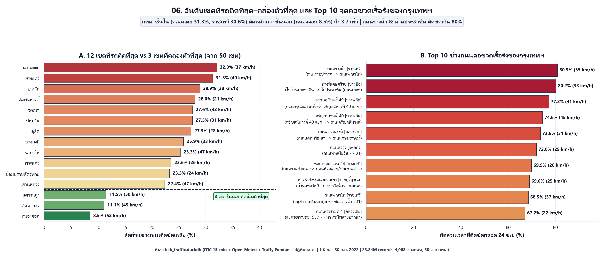
* **คลองเตย (`32.0%`)** และ **ราชเทวี (`31.3%`)** ติดหนักกว่า **หนองจอก (`8.5%`)** เกือบ **3.8 เท่า** โดยมีจุดคอขวดอันดับ 1–2 คือ **ถนนรางน้ำ (`80.9%`)** และ **ทางพิเศษศรีรัช ด่านประชาชื่น (`80.2%`)**

---

### 2. มิติเวลา ทิศทาง และพฤติกรรมปฏิทิน (Temporal, Tidal Flow & Calendar)

#### 03. Heatmap รายชั่วโมง × วัน และกราฟละเอียดระดับ 15 นาที
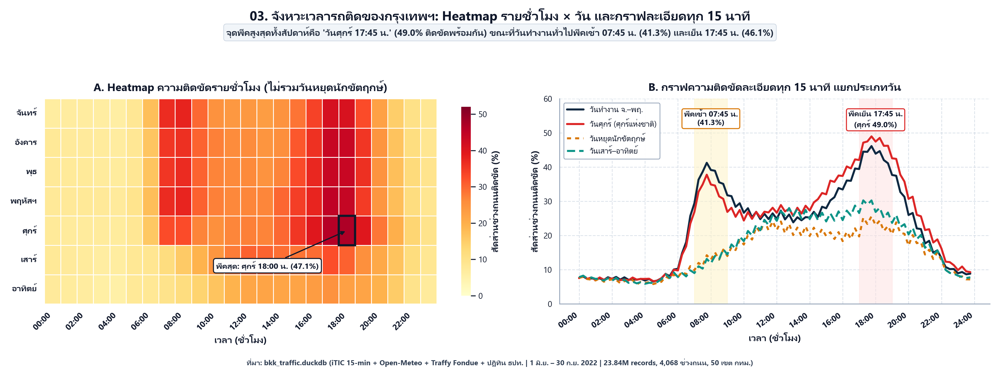
* จังหวะพีคแม่นยำระดับ 15 นาที: วันทำงาน จ.–พฤ. พีคเช้า **`07:45 น.` (`41.3%`)** พีคเย็น **`17:45 น.` (`46.1%`)** และ **ศุกร์แห่งชาติ `17:45 น.` พุ่งสูงสุดทั้งสัปดาห์ที่ `49.0%`**

#### 04. รูปแบบการไหลตามทิศทางวันทำงาน: ขาเข้า (Inbound) vs ขาออก (Outbound)
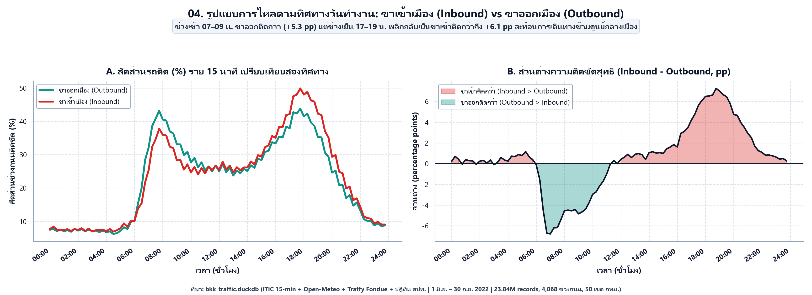
* ช่วงเช้า `07–09 น.` ขาออกติดกว่า (`+5.3 pp`) แต่ช่วงเย็น `17–19 น.` พลิกกลับเป็นขาเข้าติดกว่า (`+6.1 pp`) สะท้อนโครงสร้างเมืองแบบหลายศูนย์กลาง (Polycentric CBD)

#### 08. อิทธิพลวันเงินเดือนออก ศุกร์แห่งชาติ วันหยุด และเมทริกซ์สหสัมพันธ์ 10 ปัจจัยหลัก
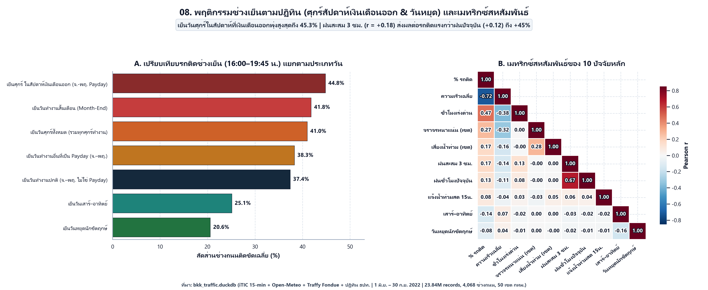
* **เย็นวันศุกร์ในสัปดาห์ที่เงินเดือนออก (`44.8%`)** และ **วันทำงานสิ้นเดือน (`41.8%`)** คือช่วงเย็นที่ติดหนักที่สุด | **ฝนสะสม 3 ชม. (`r = +0.17`)** อธิบายรถติดได้ดีกว่าฝนชั่วโมงปัจจุบัน (`r = +0.13`)

---

### 3. มิติสภาพอากาศ ฤดูมรสุม และปัจจัยน้ำท่วม (Monsoon Weather & Flood Drivers)

#### 05. แนวโน้มรายวันตลอด 122 วัน: รถติด vs ฝนสะสม vs แจ้งน้ำท่วม Traffy Fondue
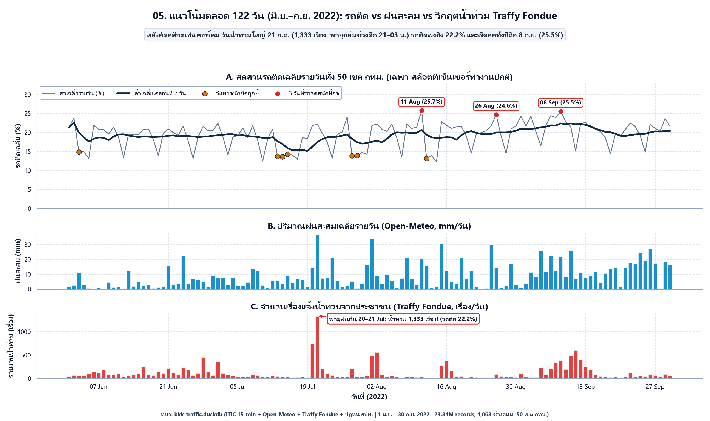
* หลังตัดสล็อตที่เซ็นเซอร์ iTIC ล่ม (`itic_active_segments = 0`) ออก วันน้ำท่วมสูงสุด **21 ก.ค. (`1,333 เรื่อง`, พายุถล่มช่วงดึก)** รถติดพุ่งขึ้นมาที่ **`22.2%`** และวันรถติดสูงสุดทั้งปีคือ **8 ก.ย. (`25.5%`)**

#### 07. ห่วงโซ่ผลกระทบ: ความแรงฝน $\rightarrow$ พื้นที่เสี่ยงน้ำท่วม $\rightarrow$ น้ำท่วมขังสด Traffy 15 นาที
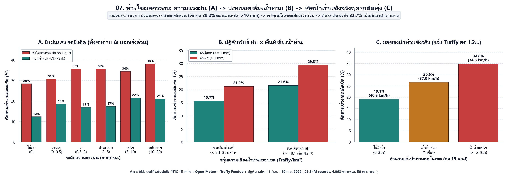
* เมื่อแยกชั่วโมงเร่งด่วนกับนอกเร่งด่วน ยิ่งฝนแรงรถยิ่งติดชัดเจน (พีค **`38%`** ตอนฝน `10–20 mm/ชม.`), ทวีคูณในเขตเสี่ยงน้ำท่วม (`+7.7 pp` vs `+5.5 pp`), และเมื่อมีแจ้งน้ำท่วมสด **`>= 2 เรื่อง/15น.`** รถติดพุ่ง **`34.8%` (`+82%`)**

#### 10. ปัจจัยน้ำท่วมระดับเขต (`traffy_road` vs `traffy_flood`) & `Area Denominator Bias`
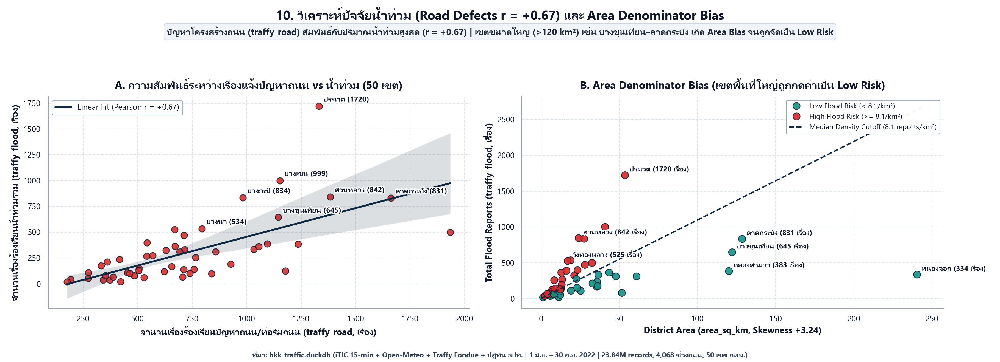
* ปริมาณน้ำท่วมระดับเขตสัมพันธ์สูงสุดกับ **ปัญหาโครงสร้างถนน/ท่อ/ก่อสร้าง (`traffy_road`, `r = +0.67`)** ไม่ใช่ปริมาณฝนเฉลี่ย (`r = +0.10`) และกราฟขวาเผย **`Area Denominator Bias`** ที่ทำให้เขตขนาดใหญ่ (`ลาดกระบัง 831 เรื่อง`, `บางขุนเทียน 645 เรื่อง`) ถูกกดค่าความหนาแน่นเป็น `Low Flood Risk`

---

### 4. มิติการกระจายตัวทางสถิติ, Log Transform, Outliers และ Split Drift

#### 09. การกระจายตัวของแต่ละฟีเจอร์ (12 Features Grid) & ผลของการทำ Log Transform (`log1p`)
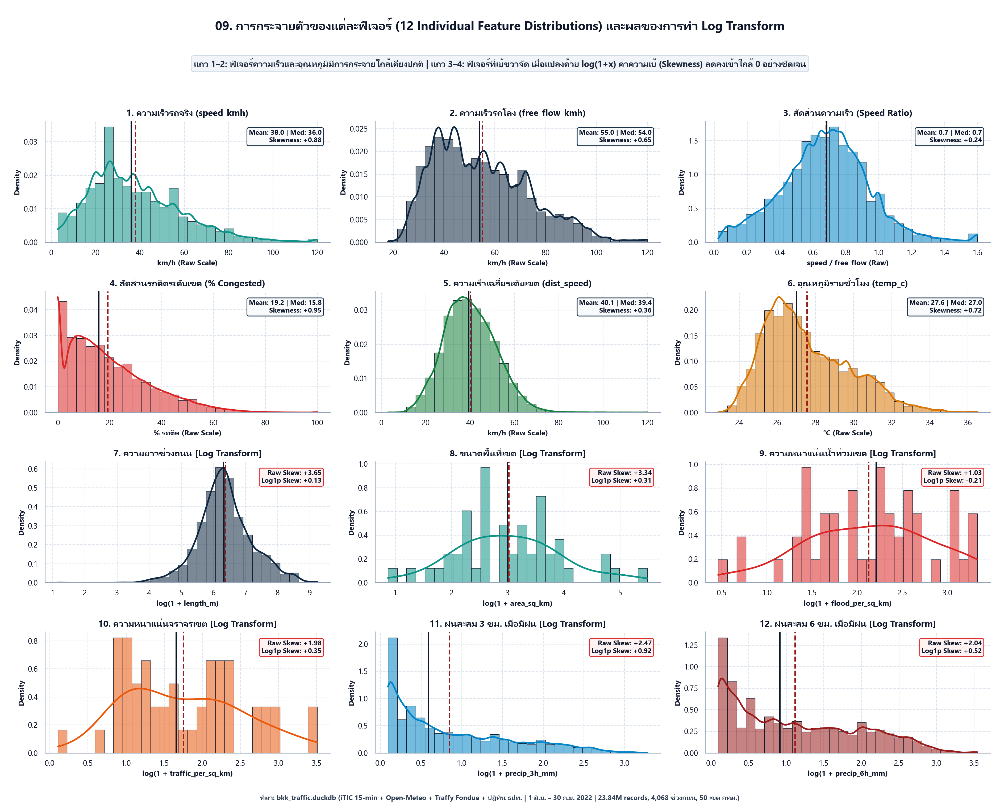
* แสดง Histogram + KDE + Mean/Median แยกครบ 12 ฟีเจอร์ และพิสูจน์ว่า `log(1 + x)` ช่วยลดค่าความเบ้ (`Skewness`) ของฟีเจอร์เบ้ขวาจัดให้เข้าใกล้ `0` เช่น `length_m` (`+3.65 -> +0.13`), `area_sq_km` (`+3.34 -> +0.31`), และ `precip_6h_mm` (`+2.04 -> +0.52`)

#### 11. ความครบถ้วนข้อมูล (`Completeness`), `Speed Change Outliers` & `Train/Valid/Test Split Shift`
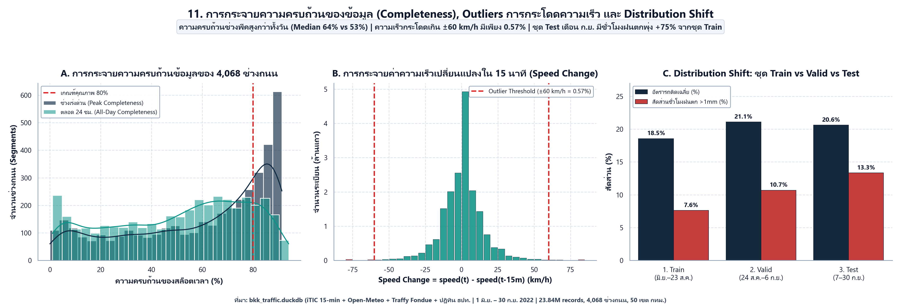
* ความเร็วกระโดดเกิน `±60 km/h` ใน 15 นาทีมีเพียง `0.57%` | ชุด `Test` เดือนกันยายนมีชั่วโมงฝนตกพุ่ง **`13.3%`** เพิ่มขึ้น **`+75%`** จากชุด `Train` (`7.6%`) ยืนยันภาวะ **Seasonal Covariate Shift**

---

## 📁 โครงสร้างโปรเจกต์และเอกสารประกอบ

```text
BKKTraffic_Project/
├── eda.py                                   # คำสั่งรันสั้น (python eda.py)
├── requirements.txt                         # ไลบรารี Python ที่จำเป็น (7 แพ็กเกจ)
├── pyproject.toml                           # ข้อมูลโปรเจกต์
├── README.MD                                # ภาพรวมโปรเจกต์และแกลเลอรีกราฟ (ไฟล์นี้)
├── EDA_INSIGHTS_REPORT.md                   # สรุปตารางสถิติพรรณนาและ Key Insights รายกราฟ
├── BLINDSPOT_ANALYSIS.md                    # วิเคราะห์จุดบอดข้อมูล (Outage Bug, Area Bias, Geometry)
├── EDA_COMPREHENSIVE_ANALYSIS_AND_ROADMAP.md# วิเคราะห์ครบ 58 ฟีเจอร์และแผนต่อยอดสู่ Modeling
├── data/
│   └── bkk_traffic.duckdb                   # ฐานข้อมูลหลัก (ไม่ถูก commit ขึ้น Git)
├── src/
│   └── eda/
│       └── run_eda.py                       # โค้ด DuckDB SQL + Seaborn Visualization (12 กราฟ)
└── outputs/
    └── eda/
        ├── eda_report.html                  # หน้าเว็บแกลเลอรีดูกราฟครบ 12 รูป
        ├── eda_summary.json                 # ค่าสถิติและการทดสอบทางสถิติ (Welch's t-test)
        └── charts/                          # รูปกราฟ PNG ความละเอียดสูง (01–12)
```

### เอกสารอ่านเพิ่มเติมใน Repo
- 📊 **[EDA_INSIGHTS_REPORT.md](EDA_INSIGHTS_REPORT.md)** — ตารางสถิติการกระจายตัว (`Mean`, `SD`, `IQR`, `Skewness`, `% Zero`) และสรุปกราฟทั้ง 12 รูป
- 🔍 **[BLINDSPOT_ANALYSIS.md](BLINDSPOT_ANALYSIS.md)** — เจาะลึกจุดบอดของข้อมูล (Sensor Outage Zero-Fill Bug, `Area Denominator Bias`, นิยาม Geometry `400m` และปัจจัยน้ำท่วมจากข้อมูลจริง)
- 🚀 **[EDA_COMPREHENSIVE_ANALYSIS_AND_ROADMAP.md](EDA_COMPREHENSIVE_ANALYSIS_AND_ROADMAP.md)** — แจกแจงฟีเจอร์ครบทั้ง 58 คอลัมน์ สิ่งที่ต้องคลีนก่อนเทรน และ Roadmap สู่โมเดลพยากรณ์ +1 ชม.
